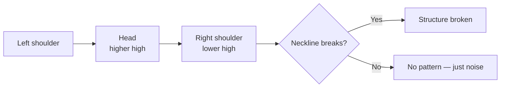

Three pushes: a high, a higher high, then a lower high. The line joining the
intervening lows is the **neckline**.

## Strip away the name

A right shoulder that fails to exceed the head is a **lower high**. A neckline
break is a **lower low**. Together that's the textbook definition of a trend
change from [[market-structure|market structure]] — nothing more.

The name adds no information. It's worth knowing only because enough participants
watch it that behaviour clusters around the neckline, which makes it a real
[[support-and-resistance|level]] for reasons unrelated to the shape.

## What separates a signal from a drawing

- The neckline must actually **break**. Unbroken, there is no pattern — this is
  where most published examples cheat, identifying them after the fact
- It should appear **after a real advance**. A reversal pattern with nothing to
  reverse is meaningless
- **Volume** should fall across the three pushes and expand on the break

> [!warning] Hindsight bias lives here
> Any sufficiently wiggly chart contains a head and shoulders if you're allowed to
> pick the swing points afterwards. The test is whether you can specify it in code
> before you see the outcome — which is exactly what [[backtesting]] forces.

## Trading it

The conventional target projects the head-to-neckline distance downward from the
break. Treat it as a rough expectation, not a level.

Confirmation from [[rsi|RSI]] divergence across the shoulders is common but not
required, and waiting for it costs you the entries that move fastest.
